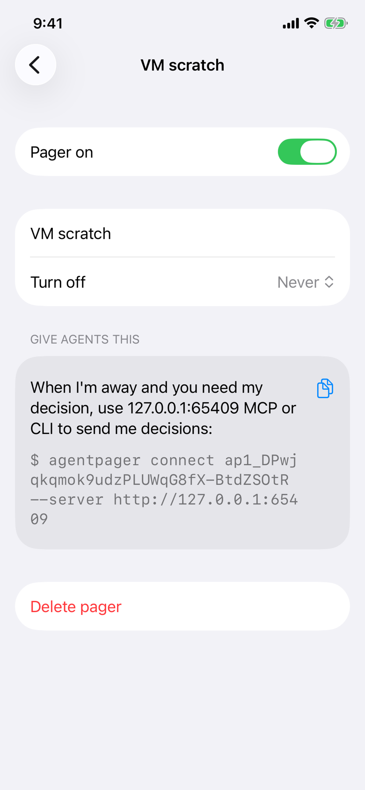
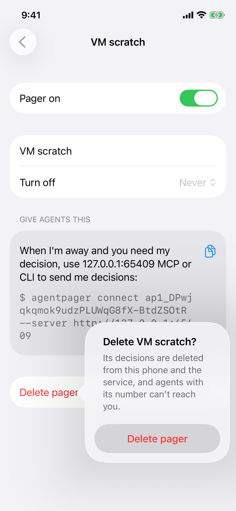

# Journey: delete

Delete a pager from its detail screen: confirm, and it is gone from the phone.

From `FlowTests/testDeletePager` in `packages/ios/AgentPagerUITests`, against a local server, the test playing the agent over the HTTP API. Each frame is the screen after the action written above it. Generated by `pnpm designs`: don't edit it by hand.

### 1. detail

Codex asks "Keep the VM's build cache?"; tap the gear.

### 2. delete-confirm

Tap Delete pager.

### 3. pagers-after

Tap Delete pager again to confirm: back on Pagers, the pager gone.

