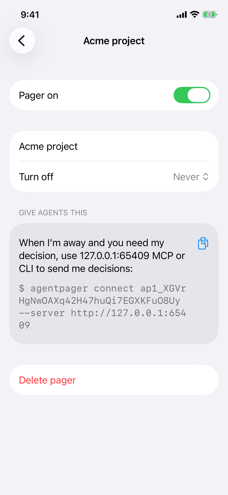
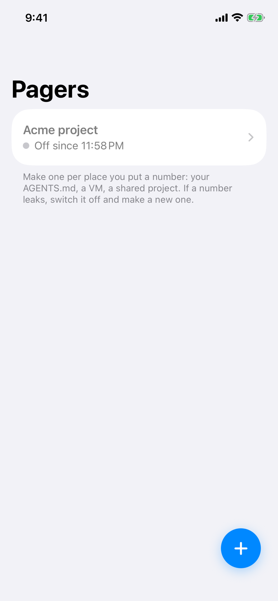
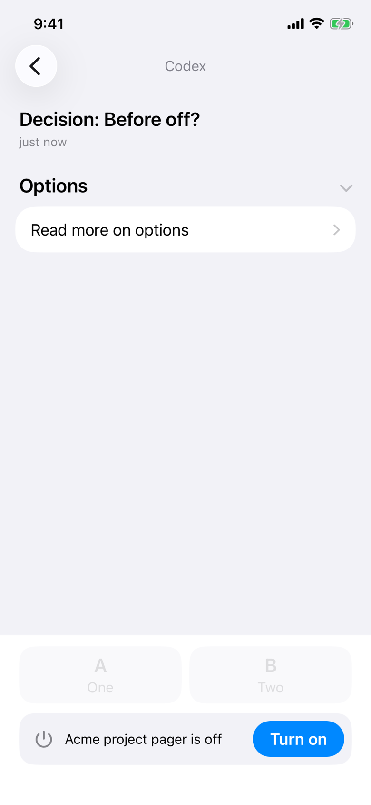
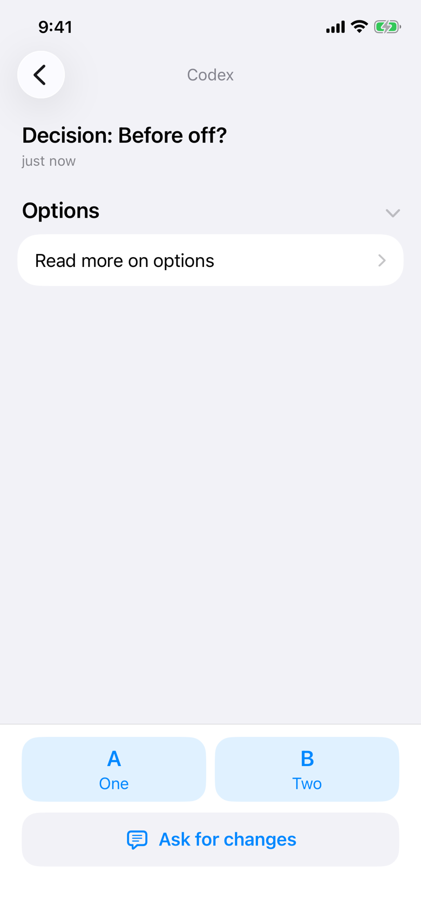

# Journey: off-and-on

Switch a pager off: its agents are refused and its decision shows Turn on; turn it back on and answer.

From `FlowTests/testOffAndOn` in `packages/ios/AgentPagerUITests`, against a local server, the test playing the agent over the HTTP API. Each frame is the screen after the action written above it. Generated by `pnpm designs`: don't edit it by hand.

### 1. detail-off

Codex asks "Before off?"; tap the gear, then switch the pager off.

### 2. pagers-off

Codex's next ask is refused PagerOff. Go back to Pagers.

### 3. decision-off

Open Acme project, then "Before off?"

### 4. decision-on

Tap Turn on: the answer bar is back.

