# Journey: pager

Make a pager; two agents connect with its number and ask; answer one through the Undo window; the agent confirms; the closed record.

From `FlowTests/testPagerJourney` in `packages/ios/AgentPagerUITests`, against a local server, the test playing the agent over the HTTP API. Each frame is the screen after the action written above it. Generated by `pnpm designs`: don't edit it by hand.

### 1. pagers-empty

Open the app with no pagers.

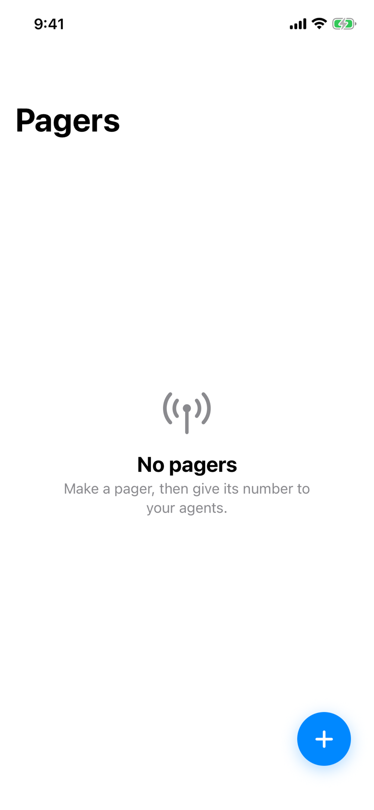

### 2. new-pager

Tap +, type the name "Work"

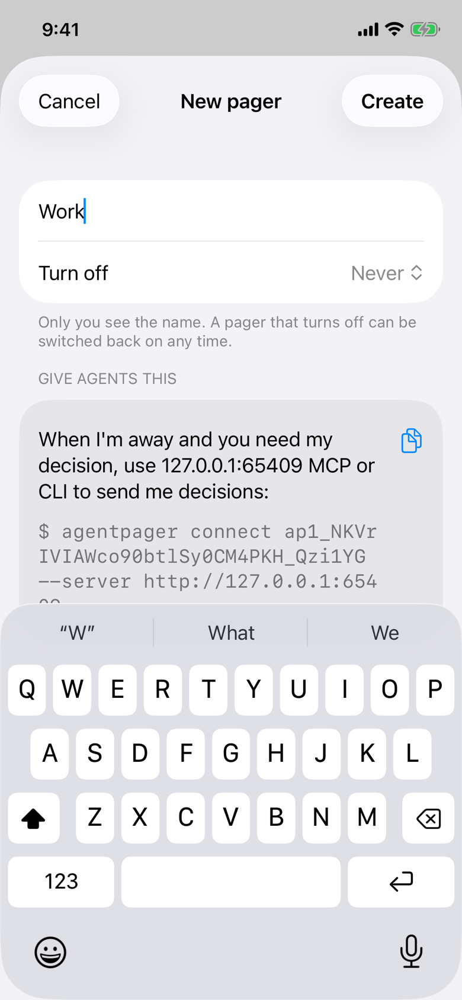

### 3. pager-detail

Tap Create, allow alerts, then tap the gear.

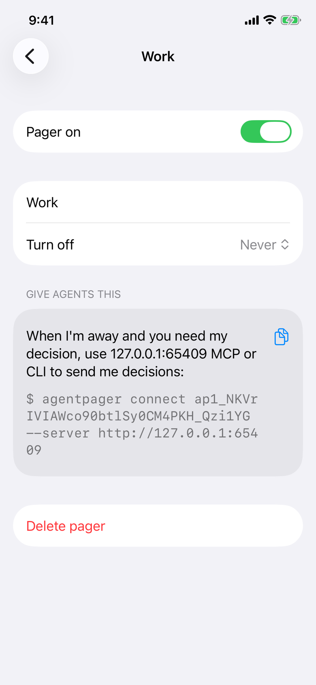

### 4. pager-empty

Go back to the new pager.

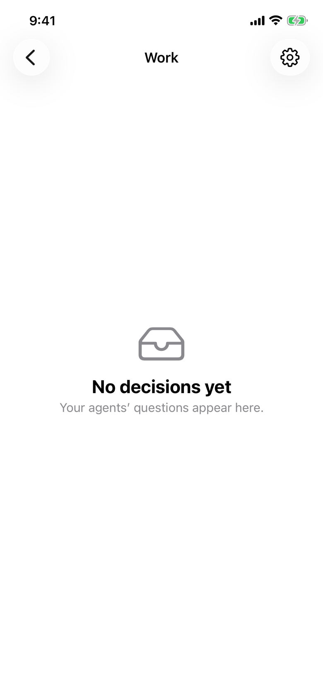

### 5. pager-open

Codex (atomic-pages) connects with the number and asks two decisions; Claude Code (agentpager) connects and asks one.

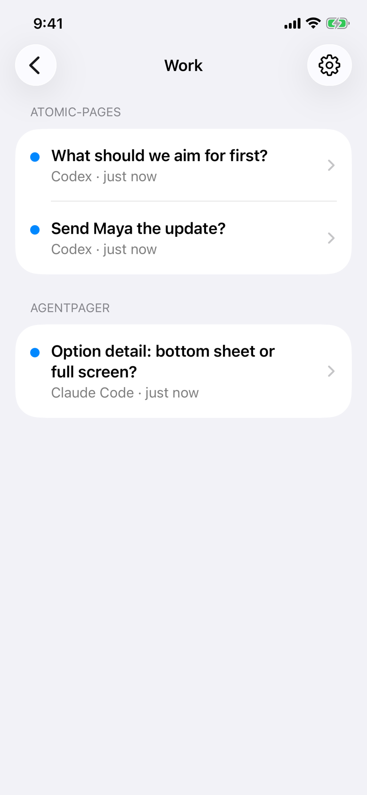

### 6. pagers-badge

Go back to Pagers.

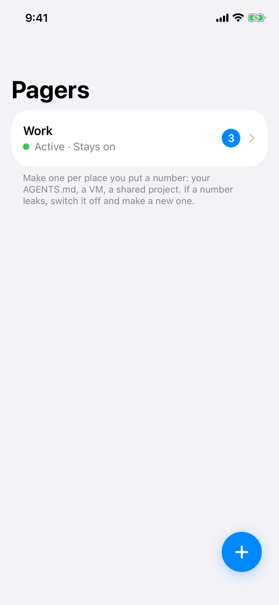

### 7. decision

Open Work, then "Send Maya the update?"

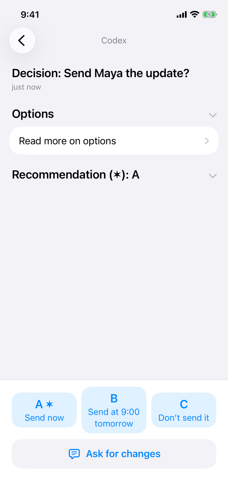

### 8. decision-picked

Tap B.

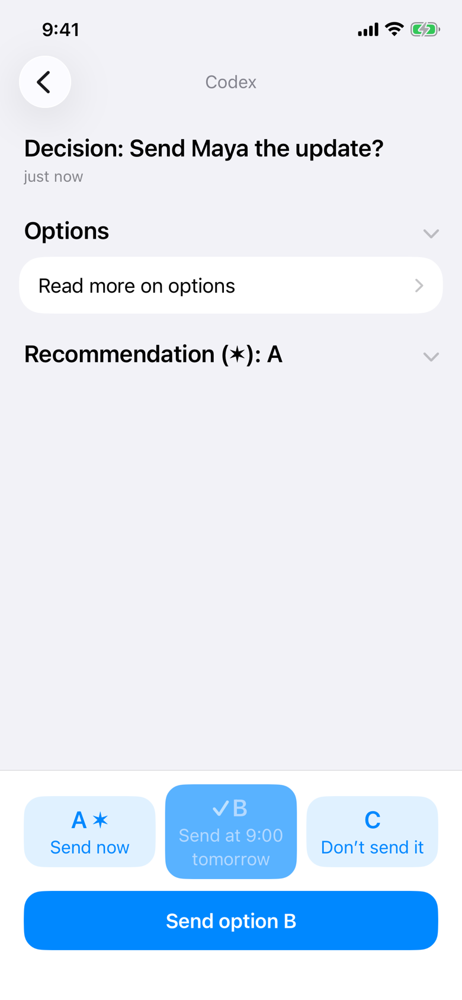

### 9. undo-window

Tap Send option B: back on the pager, the Undo window counts down.

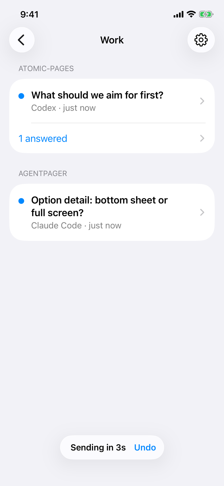

### 10. answered-list

The answer goes once Undo closes; Codex reads it and confirms. Tap atomic-pages' "answered" row.

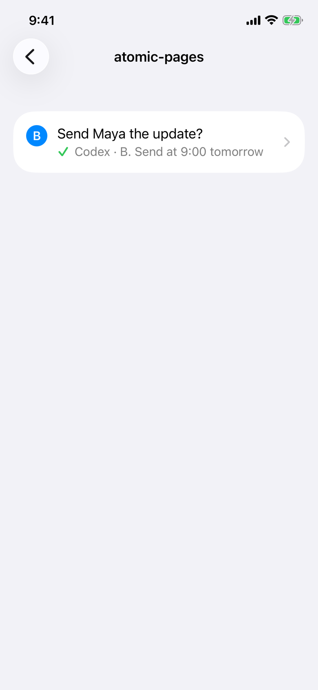

### 11. answered-decision

Tap the decision: the closed record.

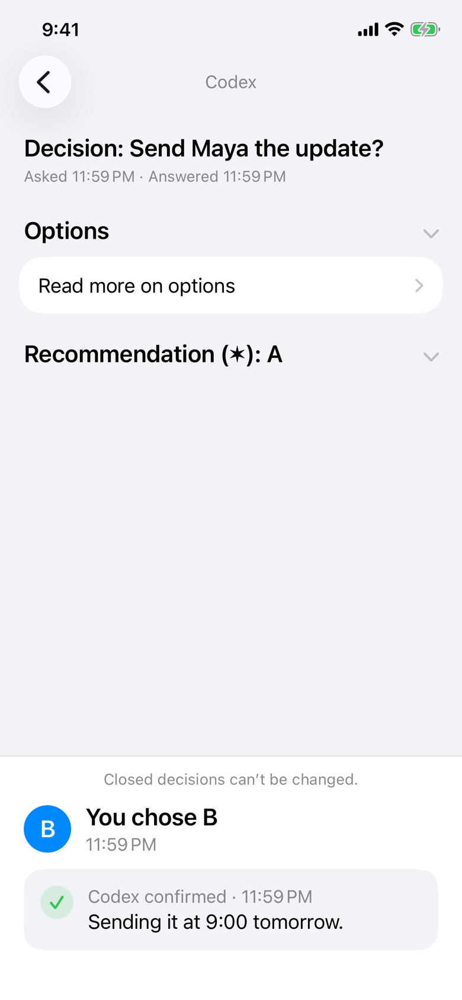
