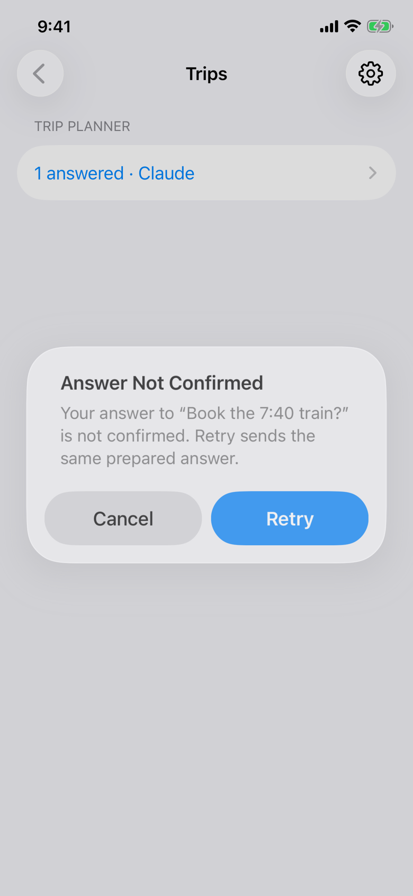
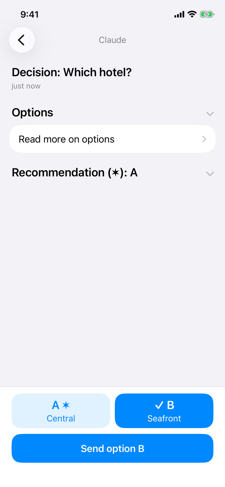
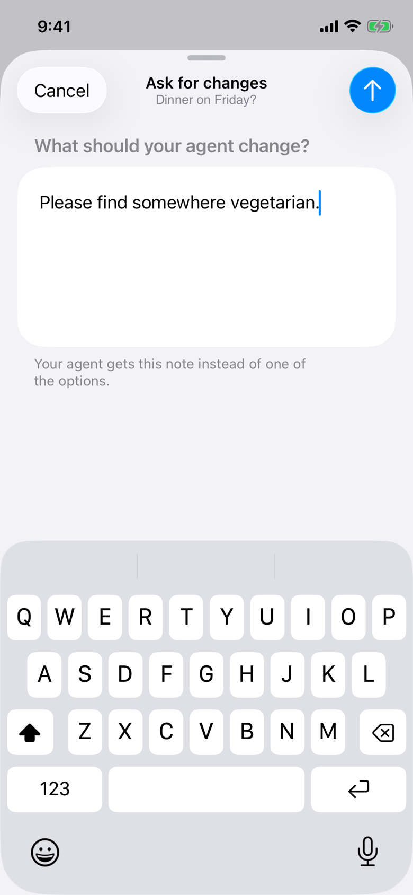
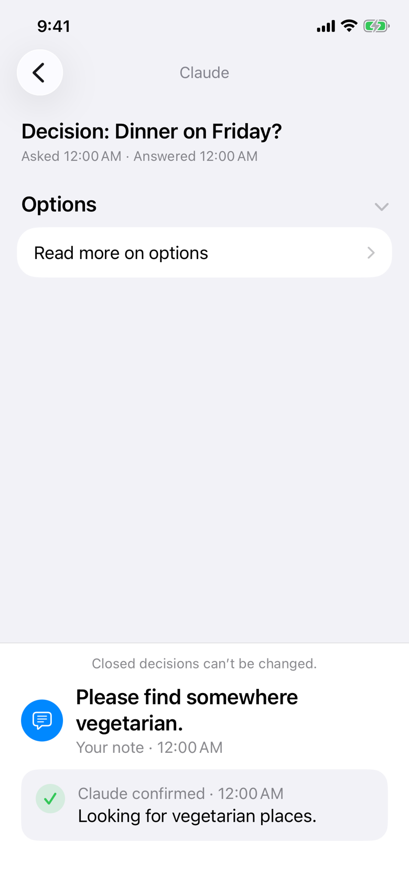

# Journey: undo-and-changes

An answer whose sends all fail (Answer Not Confirmed, Retry), Undo inside the window, leaving the app during Undo, and Ask for changes.

From `FlowTests/testUndoChangesAndNotConfirmed` in `packages/ios/AgentPagerUITests`, against a local server, the test playing the agent over the HTTP API. Each frame is the screen after the action written above it. Generated by `pnpm designs`: don't edit it by hand.

### 1. answer-not-confirmed

Claude asks "Book the 7:40 train?"; open it, tap A, Send; every retry fails.

### 2. undo-reopened

Retry sends it. Claude asks "Which hotel?"; open it, tap B, Send, then Undo inside the window.

### 3. ask-for-changes

Send again and leave the app: it sends at once. Claude asks "Dinner on Friday?"; open it, tap Ask for changes, type a note.

### 4. note-answered

Send the note; Claude confirms. Open trip planner's answered list, then the decision.

