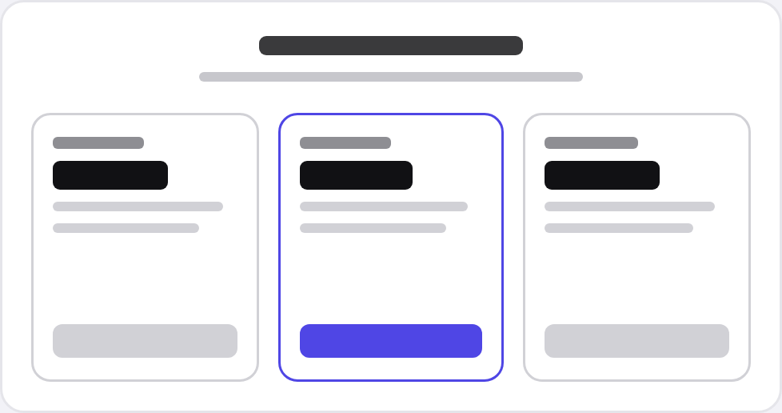
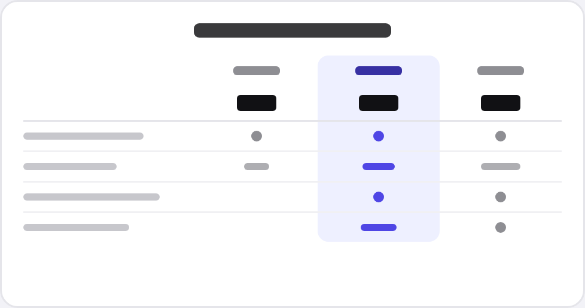
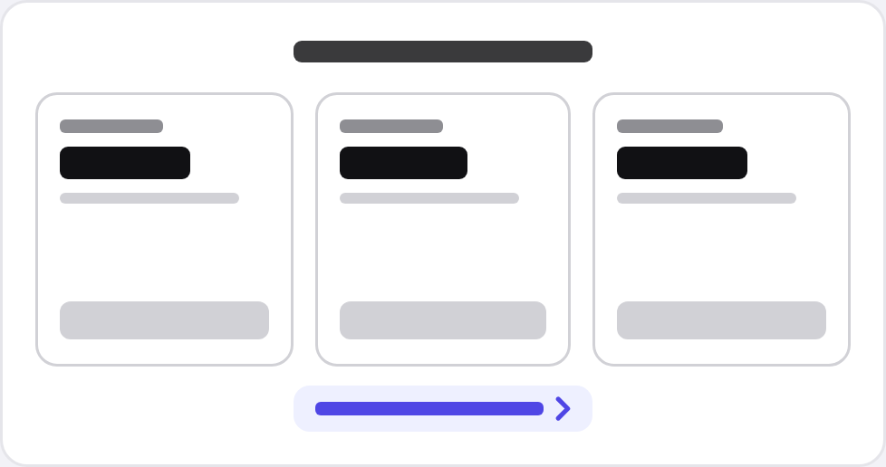

## Context: improving the pricing page
4 in 10 buyers leave on the pricing page. You asked for new layouts with the same prices.

[Read more background](background.md)

## Options

:::option A

### What A changes
- Three plan cards replace today’s list.
- Each card shows its top 4 limits.
- Reuses our existing card component.
:::

:::option B

### What B changes
- One table: plans across the top, all 14 limits down the side.
- The most popular plan’s column is tinted.
- On phones the table scrolls sideways.
:::

:::option C

### What C changes
- Today’s page stays as it is.
- A “See all 14 limits” link goes under the plans.
- It opens the full list in a drawer.
:::

## Tradeoffs
|              | A Cards        | B Table                   | C Link                |
|--------------|----------------|---------------------------|-----------------------|
| Limits shown | :orange[Top 4] | :green[All 14]            | :yellow[One tap away] |
| On phones    | :green[Stacks] | :yellow[Scrolls sideways] | :green[As today]      |
| Build time   | :green[3 h]    | :yellow[5 h]              | :green[1 h]           |

## Recommendation: B
**Why:** Buyers check seats and storage before they pay, and only B shows every limit without a tap.
**Assumes:** Most buyers compare plans on a laptop (72% last month). If phones win, pick A.

## Next steps: preview, then ship
**After this decision:** I build it behind a flag and send you a preview link in about 5 hours.
**If no decision:** Today’s page stays, and 4 in 10 buyers keep leaving there.

:::smallprint
- Prices are the same in all three. Changing them is a separate decision.
:::
