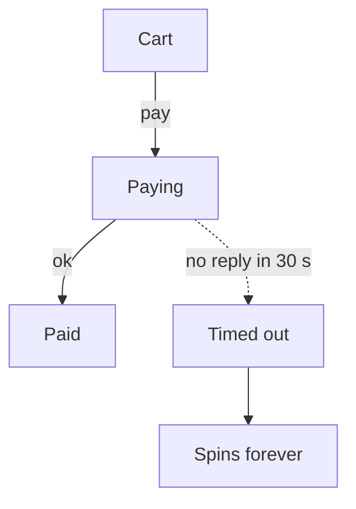

# Why checkout hangs

## A timed-out payment has nowhere to go

Nothing moves a timed-out payment on, so the page spins until the customer gives up or refreshes.

## Last week: 41 stuck, 6 charged twice
|                  |              |
|------------------|--------------|
| Orders stuck     | :red[41]     |
| Paid twice       | :red[6]      |
| Refunded by hand | :orange[$540] |
| Support tickets  | :orange[23]  |

## It started on Oct 14
The processor usually answers in about 2 s. Since Oct 14, about 1 payment in 200 takes over 30 s. Their status page shows no incident.

|                       |                 |
|-----------------------|-----------------|
| Typical reply         | 2 s             |
| Over 30 s, since Oct 14 | :red[1 in 200] |

## Refreshing is what charged people twice
- Most customers refreshed. Their first payment had failed, so the second went through once.
- 6 refreshed after the first payment had already gone through, so they paid twice.
- We refunded those 6 by hand: $540 in total.
