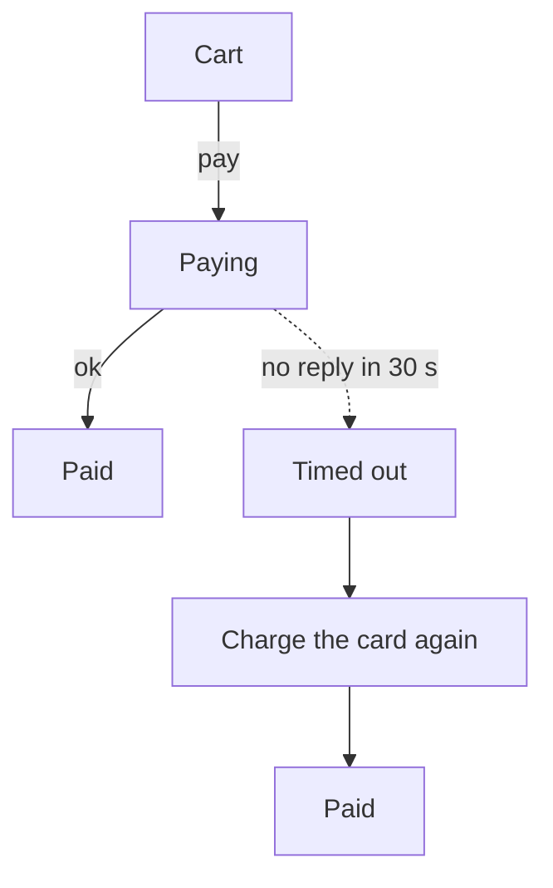
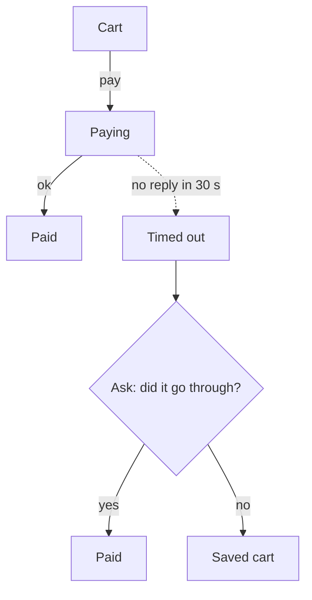
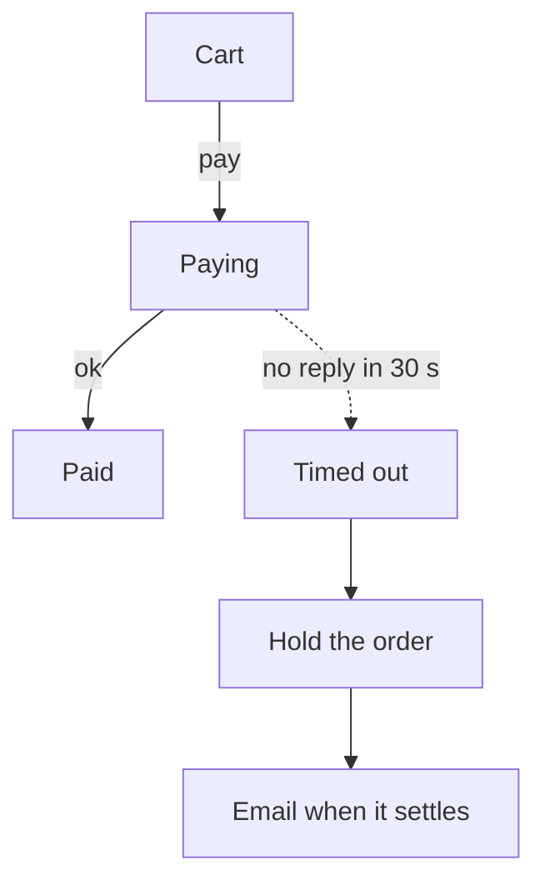

## Context: checkout hangs on slow payments
When the card processor takes over 30 seconds, checkout spins forever. Last week 41 orders got stuck and 6 people paid twice.

[Read more background](background.md)

## Options

:::option A

If the first charge went through, that’s two.
### What A changes
```diff checkout/pay.ts
  case "timeout":
-   return spin()
+   return retry(order)
```
[Design notes on all three](design.md)
:::

:::option B

Nobody pays twice. If it didn’t go through, they retry from their cart.
### What B changes
```diff checkout/pay.ts
  case "timeout":
-   return spin()
+   const paid = await status(order)
+   return paid ? done() : backToCart()
```
[Design notes on all three](design.md)
:::

:::option C

Nobody pays twice, but they wait for an email.
### What C changes
```diff checkout/pay.ts
  case "timeout":
-   return spin()
+   await hold(order)
+   return emailWhenSettled(order)
```
[Design notes on all three](design.md)
:::

## Tradeoffs
|               | A Retry            | B Check           | C Hold                   |
|---------------|--------------------|-------------------|--------------------------|
| Charged twice | :red[Can happen]   | :green[Never]     | :green[Never]            |
| Customer      | :green[Does nothing] | :yellow[Retries] | :orange[Waits for email] |
| Build time    | :green[1 h]        | :green[2 h]       | :red[1 day]              |

## Recommendation: B
**Why:** Nobody pays twice, and it ships today.
**Assumes:** The processor answers a status check in under 5 s (its docs say 1 s). If not, pick C.

## Next steps: ship behind a flag
**After this decision:** I ship it behind a flag today and watch the next 50 timeouts.
**If no decision:** Checkout keeps hanging, about 6 stuck orders a day.

:::smallprint
- Ruled out: a longer timeout. It moves the hang; it doesn’t fix it.
- Last week’s 41 stuck orders stay as they are. Refunds are a separate decision.
:::
