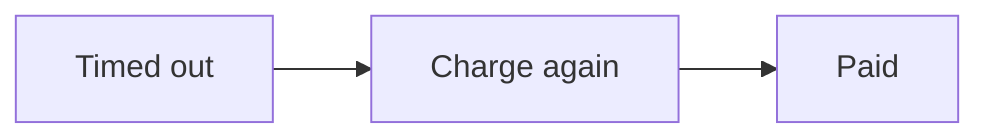
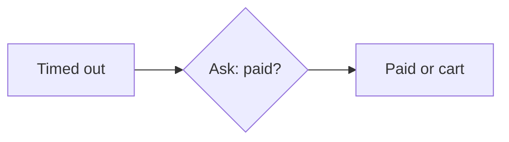
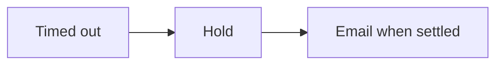

# Three ways to handle a timeout

## A. Retry
Prioritizes the least work for customers

Checkout charges the card again, without asking the customer.

**Can go wrong:** :red[Charged twice] if the first charge went through but its reply was lost.

**Effort:** :green[1 h]

## B. Check first ✶ Recommended
Prioritizes never charging twice

Checkout asks the processor whether the payment went through. Its status endpoint answers in about 1 s. Paid orders finish; unpaid ones go back to a saved cart.

**Safe to repeat:** The check uses the order id, so asking twice can never charge twice.

**Can go wrong:** :yellow[Tries again] if the check also times out, the customer lands on the saved cart.

**Effort:** :green[2 h]

## C. Hold and email
Prioritizes certainty over speed

Checkout holds the order until the processor’s webhook arrives, usually within 10 minutes, then emails the customer the result.

**Can go wrong:** :orange[Waits] the customer leaves not knowing if they paid.

**Effort:** :red[1 day]

## What I tested
- Replayed last week’s 41 timeouts against B in staging: 41 resolved, 0 double charges.
- Called the status endpoint 1,000 times: 99.8% answered within 1 s, none over 5 s.
- Read the processor’s docs: status checks are free and don’t count toward rate limits.
