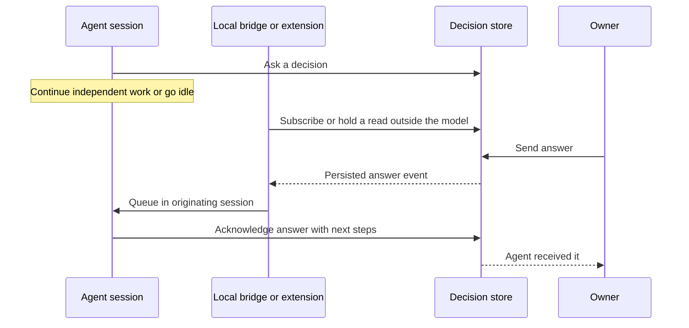

# Plannotator Inbox: what AgentPager should borrow

Research date: 2026-10-27. Recommendation, not an approved change to the Blueprint.

**Recommendation:** keep AgentPager's installation-free HTTPS/MCP entry point, and evaluate an optional local bridge that receives answers outside the model and delivers them to the exact agent session. The major improvement is automatic continuation after the agent stops waiting. Replacing long polling with a socket alone does not provide that.

## Evidence and limits

- **Verified by inspection:** AgentPager origin/main `a7ba1792d2461919ed6ca82fff353afa2a1effa5`, matching GitHub main at lookup. Read strategy → design promises → design code. This checkout has no generated `packages/app/`; claims below concern its contract, not a tested live deployment.
- **Verified by inspection:** Plannotator main `a104c2068f23ec9cc95c5216ad4f679aa8c9bde2`. [Source notes](plannotator-source-notes.md) pin implementation evidence. Main may contain features beyond a published binary.
- **Verified locally:** `codex-cli 0.164.0`; `codex queue --help` exposes `--thread` and `--message`. No messages were injected and no agent configuration was changed.
- **Documented, not exercised:** official Codex queue/app-server, Claude Channels, Bun compilation and Cloudflare WebSocket behavior. No end-to-end wake, security test, cost measurement or latency benchmark was run.

## 1. What makes Inbox feel different

There are three independent problems:

1. **Transport:** how a human answer gets from storage to a client process.
2. **Session delivery:** how that process inserts the answer into the correct conversation and starts another turn.
3. **Receipt:** how the owner learns whether it was merely stored, queued, read, or acted on.

Plannotator supplies client-specific machinery for the second problem. It can return from `send_message`, let the agent do other work or go idle, then deliver the reply into that conversation. This is materially better than relying on the model to remember another read.

The delivered feedback is formatted prompt text: subject, message ID, provenance line, the owner's body, and thread/tool references. There is no special decision format that makes the model listen by itself; the host API schedules the turn. Structured IDs and explicit provenance are still worth copying. [Prompt formatter](https://github.com/backnotprop/plannotator/blob/a104c2068f23ec9cc95c5216ad4f679aa8c9bde2/packages/shared/inbox/connection.ts#L811-L875).

It still polls. Its native agent links long-poll a local `/api/inbox/bridge/poll` route with a 20-second hold; Claude's mod schedules work on a one-second host tick. This is ordinary code, not recurring model turns. A held request can return immediately when the answer arrives: the hold length is not an extra 20-second delivery delay. Unsupported clients use `wait_for_reply`, up to 50 seconds per call. [Agent-link implementation](https://github.com/backnotprop/plannotator/blob/a104c2068f23ec9cc95c5216ad4f679aa8c9bde2/packages/shared/inbox/agent-link.ts), [Claude Inbox implementation](https://github.com/backnotprop/plannotator/blob/a104c2068f23ec9cc95c5216ad4f679aa8c9bde2/apps/hook/hooks/mod/inbox.ts).

## 2. The mechanisms are different for each client

| Client | What Plannotator actually does | What an AgentPager integration would require |
| --- | --- | --- |
| Codex | Local Inbox invokes `codex queue --thread <UUID> --message <text>`. Learns originating thread from Codex MCP metadata or shell environment. Plannotator gates this at CLI 0.149+. | Local executable and exact thread binding. No dedicated Codex plugin is inherently needed; a plugin could package setup. Qualify each supported Codex surface. |
| Pi | Extension receives replies and calls `pi.sendUserMessage` with `deliverAs: "followUp"`, or `"steer"` for explicit immediate delivery. | Small Pi extension, possibly sharing a bridge core. Extension has host authority to start a turn. |
| Claude Code | Plannotator plugin's mod long-polls, then uses `$.prompt.submit`; explicit Send now can append into the current turn. Its docs name hooks-module support in Claude Code 2.1.287+ and exclude noninteractive/SDK sessions. | A compatible mod, or an alternative official Channels integration. These are different interfaces and need separate support claims. |
| OpenCode 2 | Plugin uses session prompt APIs and runtime capability checks to deliver; older/unsupported runtimes fall back to waiting. | OpenCode adapter if product reach warrants it. |
| Generic MCP / HTTPS client | No universal wake primitive; agent calls `wait_for_reply`. | Retain AgentPager's held-read path. Installing an MCP server alone does not guarantee unsolicited messages become turns. |

Sources: [Codex routing and version gates](https://github.com/backnotprop/plannotator/blob/a104c2068f23ec9cc95c5216ad4f679aa8c9bde2/packages/core/inbox-codex.ts), [queue delivery and failure handling](https://github.com/backnotprop/plannotator/blob/a104c2068f23ec9cc95c5216ad4f679aa8c9bde2/packages/server/inbox-codex-wake.ts), [Pi adapter](https://github.com/backnotprop/plannotator/blob/a104c2068f23ec9cc95c5216ad4f679aa8c9bde2/apps/pi-extension/inbox.ts), [Claude mod guide](https://github.com/backnotprop/plannotator/blob/a104c2068f23ec9cc95c5216ad4f679aa8c9bde2/docs/agent-guides/claude-code-mod.md), [Inbox client guide](https://plannotator.ai/docs/reference/inbox/).

Official OpenAI documentation confirms `codex queue` targets an existing session by UUID or exact name. Prefer UUIDs. Plannotator documents queueing after a busy turn and retaining closed-thread messages until resume; a queue exit of zero is not proof the model read the answer. One-shot `codex exec` runs are deliberately excluded from its wake path. Do not interpret this as the ability to start an arbitrary terminated agent process. [Official Codex CLI reference](https://learn.chatgpt.com/docs/cli/reference), [Plannotator Codex wake](https://github.com/backnotprop/plannotator/blob/a104c2068f23ec9cc95c5216ad4f679aa8c9bde2/packages/server/inbox-codex-wake.ts).

Codex app-server additionally exposes `turn/start` and `turn/steer`. That is an option when building a client that owns the connection and lifecycle; it is a larger integration than queueing to existing sessions. Its CLI documentation labels app-server experimental. We should not assume attaching another app-server process safely controls any already-running desktop conversation. [Official app-server protocol](https://learn.chatgpt.com/docs/app-server), [CLI caveat](https://learn.chatgpt.com/docs/cli/reference).

### Claude has an official alternative worth testing

Official Claude Channels are local stdio MCP servers declaring `claude/channel` and emitting `notifications/claude/channel`. Claude queues incoming events for processing; events only arrive while the session is open. Notification write success is not a processing acknowledgement, and policy can silently discard events. They are a research preview; custom channels require a development flag and interactive confirmation rather than ordinary allowlisted production installation. Organization policy and authentication/provider restrictions also apply. This is a promising experiment, not evidence we can ship AgentPager as a generally available channel today. [Channels overview](https://code.claude.com/docs/en/channels), [protocol, delivery and allowlist requirements](https://code.claude.com/docs/en/channels-reference).

Channels can separately relay native tool approvals using a request ID and allow/deny verdict. That would let AgentPager carry a real harness permission request rather than only a model-authored decision card. It adds authority and should be a separate, explicitly designed capability; merely receiving an owner comment must not grant native tool permission. Preserve SI8's exact-proposal requirement and distinguish a preview from full arguments. [Permission relay](https://code.claude.com/docs/en/channels-reference#relay-permission-prompts).

## 3. How this compares with AgentPager today

AgentPager already specifies a 50-second held answer read and delivery within one second of accepted Send to a waiting caller. The phone polls every three seconds. Its MCP server is stateless Streamable HTTP, with session authority in tool arguments. C2 explicitly says a stopped agent is not woken. [Answer contract](../../packages/blueprint/design/schemas/exchange.ts), [routes and authentication](../../packages/blueprint/design/effects/routes.ts), [C2](../../packages/blueprint/design/capabilities/C2-agent-starts-from-one-url.md), [K1](../../packages/blueprint/design/metrics/K1-visible-within-five-seconds.md).

Therefore the likely gain is fewer repeated wait calls and reliable continuation across idle turns, not a demonstrated latency improvement. A shell program can loop over the existing held-read API without consulting the model, but it still needs a host adapter to wake a finished turn. A socket to an idle process does not itself schedule inference.

SP5 currently promises nothing to install for agents with HTTPS or custom MCP. Mandatory plugins would narrow that reach, especially hosted chat apps. An optional enhanced mode can preserve the simple path. The current C2 caveat, D2 client qualification, K1 latency measurement and routes would need explicit additions before a bridge becomes a product promise. [Strategy](../../packages/blueprint/strategy/STRATEGY.md), [client dependency](../../packages/blueprint/design/dependencies/D2-agent-clients.md).

## 4. Does a Bun binary help?

Yes as distribution. Bun can bundle JavaScript/TypeScript, dependencies and its runtime into one executable, built per target OS/architecture. The user need not separately install Bun or Node. Compilation does not confer a host messaging API, sandbox the process, authenticate the owner or encrypt the relay. [Bun executable documentation](https://bun.sh/docs/bundler/executables).

A proposed `agentpager bridge` could own pairing credentials, HTTP/MCP calls, durable delivery state and a Codex queue adapter. A Pi extension could call the same core or connect through a narrowly scoped local interface. A Claude Channels subprocess could use the same protocol. For a first spike, use the existing held-read endpoint from ordinary code: a new transport is not needed to prove the main UX improvement. If subscriptions are later justified, an outbound authenticated WebSocket to the existing session Durable Object avoids inbound ports on the user's machine. Cloudflare supports Durable Object WebSockets and hibernation; actual billing and reconnect behavior need measurement, not assumptions. [Cloudflare WebSocket guidance](https://developers.cloudflare.com/durable-objects/best-practices/websockets/).

An extension alone can own the connection for a supported client. A separate daemon becomes useful if we want one connection manager across agents, durable queues independent of agent restarts, or a shared protected credential store. Avoid requiring both a daemon and extensions until that benefit is demonstrated.

## 5. Security: what improves, what changes

**Assessment:** push versus polling is not an authentication boundary. A local bridge can reduce accidental exposure by keeping the AgentPager capability out of model arguments and transcripts. It also becomes installed code capable of delivering prompts to powerful agents. Same-user arbitrary code or an unrestricted shell can generally undermine a same-user bridge; hiding keys from model context is not isolation from that agent's process authority.

Plannotator itself trusts local non-browser processes: its local MCP endpoint has no token, while bridge/control routes use a shared owner-readable token plus loopback Host/no-Origin checks. Browser-origin defenses are useful but are not per-agent access control. That local trust assumption should be an explicit choice rather than an accidental consequence of installing a binary. [Boundary and enforcement](https://github.com/backnotprop/plannotator/blob/a104c2068f23ec9cc95c5216ad4f679aa8c9bde2/packages/server/inbox.ts#L2241-L2275), [registry permissions](https://github.com/backnotprop/plannotator/blob/a104c2068f23ec9cc95c5216ad4f679aa8c9bde2/packages/shared/inbox/registry.ts#L109-L121).

| Proposed property | What is required; what it actually protects |
| --- | --- |
| Exact-session delivery | Bind local host, thread UUID, AgentPager session, decision ID, answer ID and proposal version/hash at creation. Reject cross-session and stale answers; don't route by conversation name or model-supplied arbitrary path. |
| Credential containment | Bridge retains narrowly scoped, expiring relay credentials; no tokens in URLs, model arguments, logs or argv. Local IPC uses stdio or a private socket; a loopback port alone does not authenticate another local process. |
| Safe continuation | Queue after the current turn by default. Explicit steering is separate. A reply is data bound to a decision, not executable shell text or a broad grant of permission. |
| Replay and crash handling | Persist event IDs/cursor and deduplicate delivery. Distinguish receipt, queued, model acknowledgement and action result. If queue outcome is unknown after a crash, surface uncertainty; retries must not repeat a side effect. |
| Retention and revocation | End/expiry invalidates delivery too, including replies already waiting locally. Any local cache must obey the product's deletion/lifetime promise and a restarted bridge must not resurrect expired authority. |
| Supply chain | Publish verifiable platform builds and deliberate updates; qualify adapters against host versions. A compiled binary is still trusted executable code. |
| Confidentiality from relay | End-to-end encrypt on phone and bridge with authenticated pairing. HTTPS currently protects the transport, not data from the service itself. Native installation is not essential for browser cryptography, but provides a persistent agent-side endpoint and key lifecycle. |

These are design requirements and threat-model judgments, not properties tested here. E2EE would materially change server-side validation/rendering and recovery: authenticate ciphertext envelopes and validate plaintext at endpoints; account for the browser UI delivery trust boundary, which can undermine encryption if the server serves malicious client code. Plannotator's source contains phone/relay encryption work, but its public Inbox reference emphasizes loopback/tailnet access; published availability was not established. Do not claim its entire phone model is shipped or equivalent to ours. [Phone/relay security design and stated proof](https://github.com/backnotprop/plannotator/blob/a104c2068f23ec9cc95c5216ad4f679aa8c9bde2/docs/agent-guides/inbox-phones-and-security.md).

One concrete Plannotator tradeoff to avoid copying: it puts the human's feedback in the `codex queue --message` process arguments, briefly visible to process inspection. An AgentPager spike could instead queue only an opaque answer/event reference and ask the model to retrieve that exact answer via a local tool. This adds one purposeful read after wake but keeps feedback out of argv. It does not keep the eventual answer out of the model transcript. Alternatively evaluate app-server IPC when lifecycle ownership and stability permit. [Explicit argv caveat in source](https://github.com/backnotprop/plannotator/blob/a104c2068f23ec9cc95c5216ad4f679aa8c9bde2/packages/server/inbox-codex-wake.ts).

Keep SI4 intact: neither bridge transport receipt nor `codex queue` success should produce the existing agent acknowledgement. Only the agent's explicit acknowledgement of the stored answer and next steps should do that. [I6](../../packages/blueprint/design/invariants/I6-send-and-acknowledgement.md).

## 6. A small next experiment

**Recommendation, not implementation authorization:** prove Codex first because the machine already exposes the required queue command. Add Pi as the next adapter; evaluate Claude Channels separately for preview restrictions. Do not first rewrite the cloud transport or make installation mandatory.

Acceptance criteria for the experiment:

1. Agent posts a decision, returns from its tool call and goes idle. Owner answers from the phone; the exact originating thread starts again without a model polling loop.
2. Busy thread gets a queued reply without disrupting work; a closed thread has a clear pending state until a supported resume; a one-shot exec caller is explicitly unsupported for automatic wake.
3. Cross-thread answers, duplicate events, lost queue responses, bridge restarts, session end/expiry and host-version mismatch have explicit outcomes. No duplicate business action is inferred to be safe merely because prompt delivery was deduplicated.
4. Credentials and feedback never enter process arguments; the answer read returns the exact frozen proposal and answer. Agent acknowledgement remains distinct from queued receipt.
5. Measure idle-answer-to-turn-start time, tool calls and tokens spent waiting, install effort and reconnection behavior against the current held-read path. Keep existing waiting-agent latency separate from next-turn scheduling latency.

If that succeeds, amend the Blueprint with optional bridge delivery, supported clients, lifecycle/error states and evidence requirements. Decide on a multi-session subscription and E2EE only after their distinct value is established.
